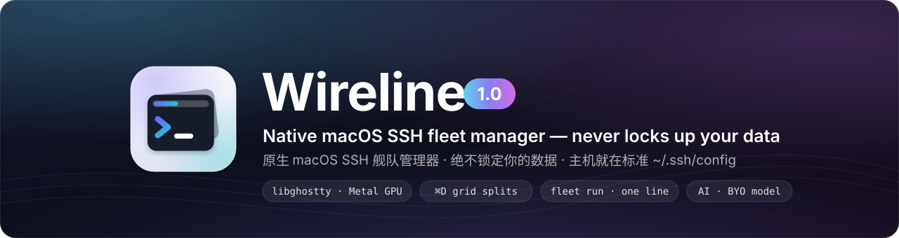
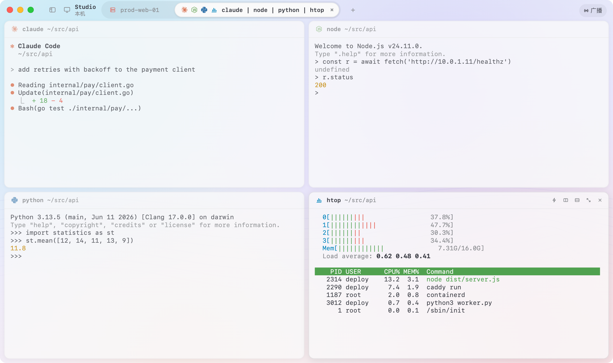
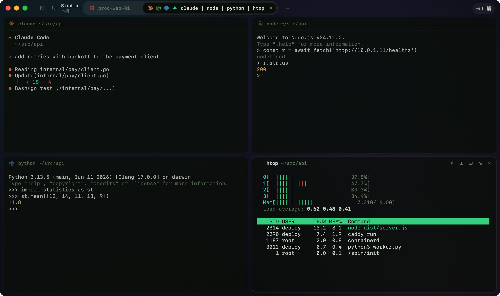
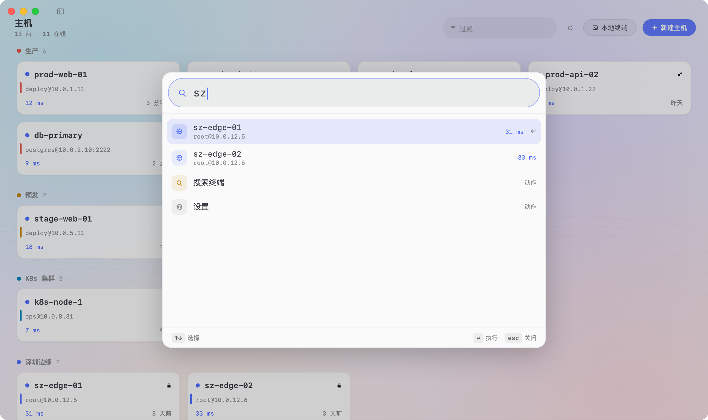
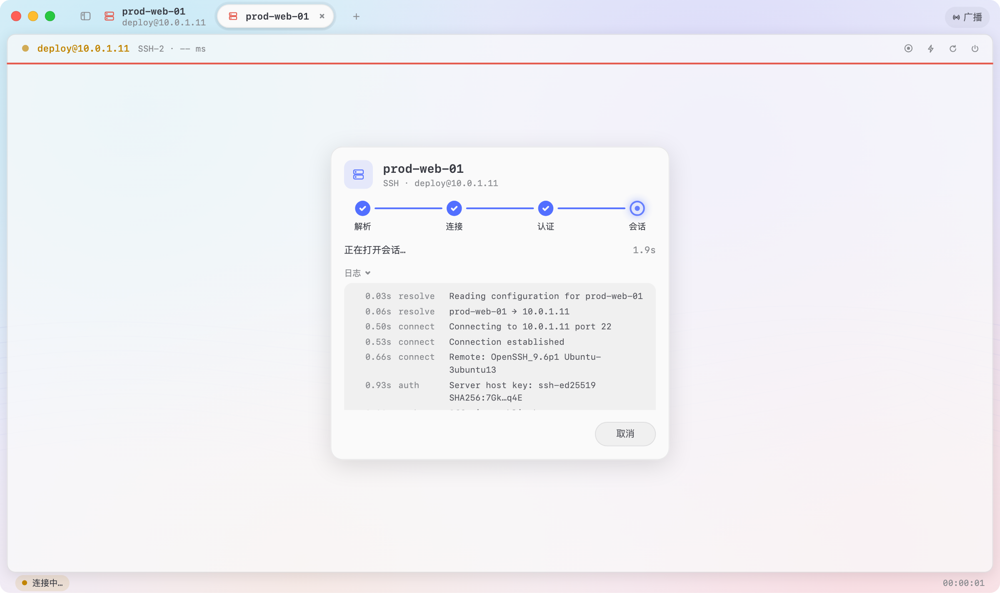
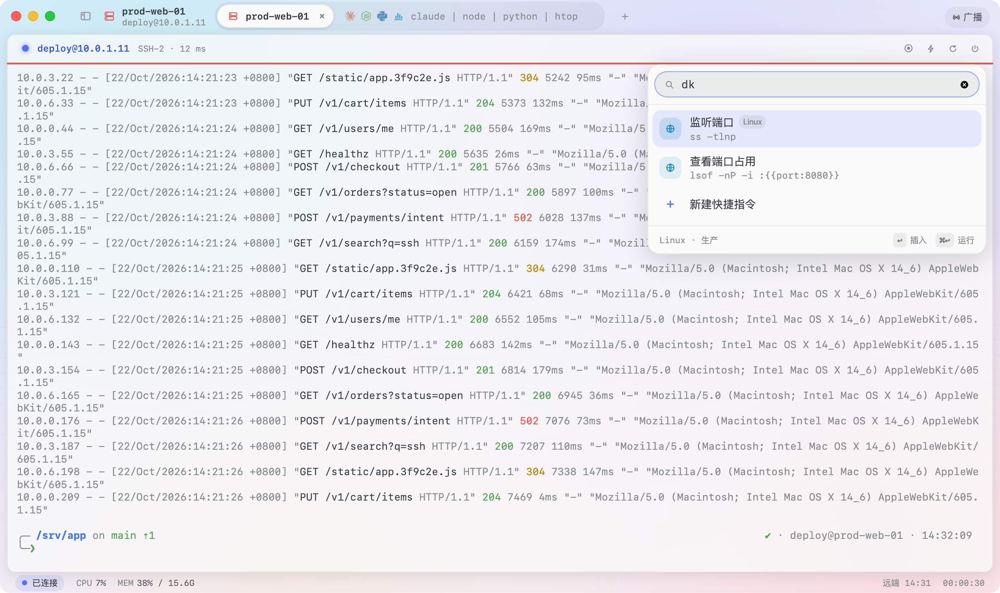
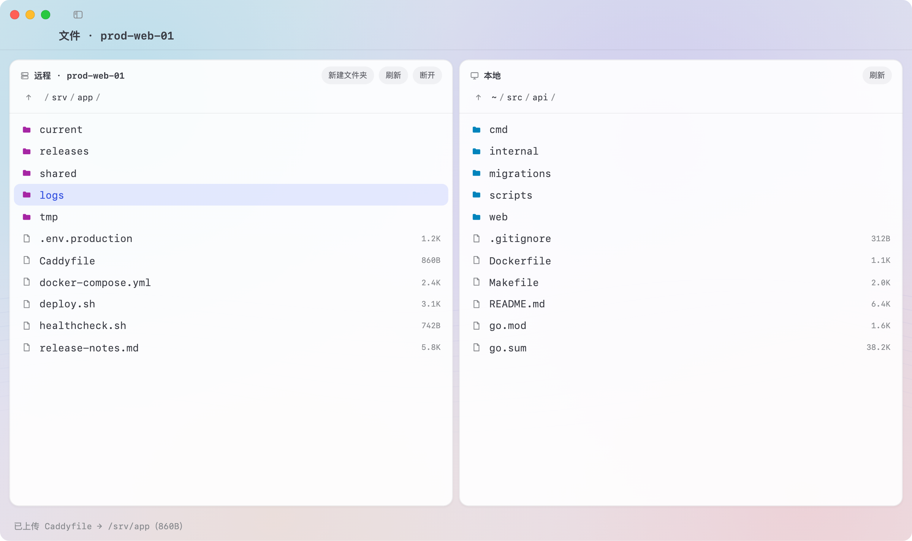
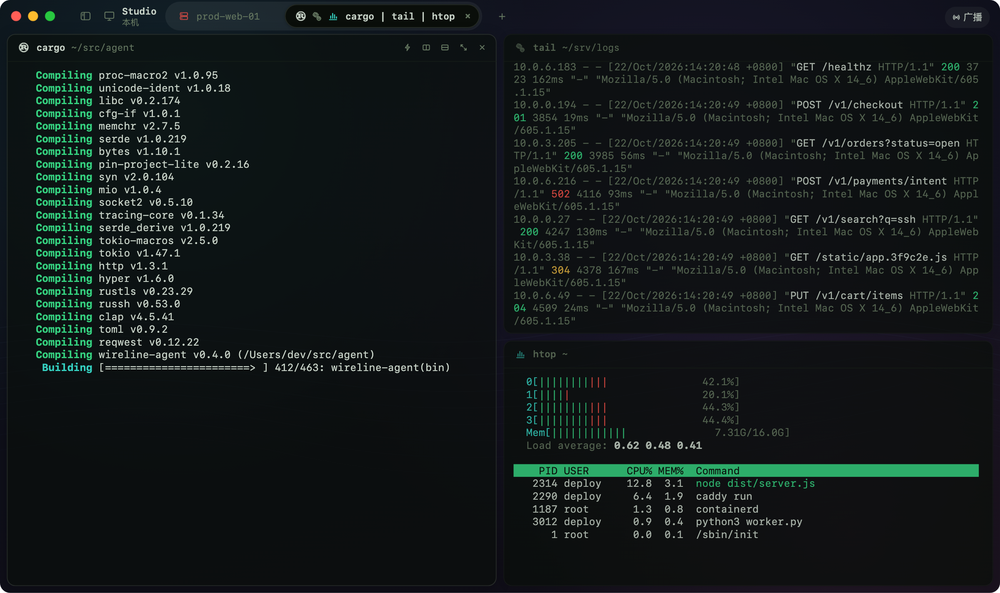
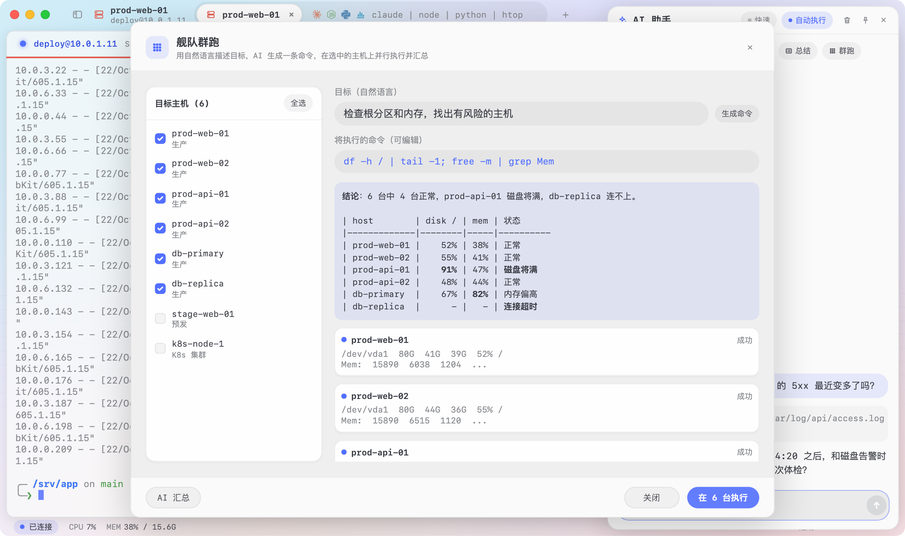

<p align="center">
  
</p>

<p align="center">
  <a href="README.md">English</a> · <b>简体中文</b>
  &nbsp;·&nbsp;
  <a href="https://github.com/almightyYantao/wireline/releases/latest">下载</a>
  &nbsp;·&nbsp;
  <a href="https://almightyyantao.github.io/wireline/">官网</a>
  &nbsp;·&nbsp;
  <a href="https://yantao.wiki">博客</a>
</p>

> 原生 macOS SSH **舰队管理器** · 绝不锁定你的数据 · AI 把批量运维变成一句话

**你的数据永远不被扣押。** 主机配置**始终以标准 `~/.ssh/config` 为唯一数据源**——图形界面只是这份标准配置之上的高效外壳。卸载 Wireline 后，`ssh` / `scp` / `rsync` / VS Code Remote 仍能直接读取同一份配置。没有私有账号、没有你退不出的云同步、也永远用不上「导出」按钮。这就是 Wireline 和那些把主机锁进自家格式的 SSH 客户端的根本区别。

**为多主机而生，不是单机。** 别名、分组、批量是一等公民:选中一整个分组，用一句话描述任务，Wireline 并发铺开到每台机器,再把所有主机的输出汇总成一个结论或一张对比表——**机器不用先连上**。纯 AI 终端做不到这件事,因为它没有你的主机图谱。

**AI 是杠杆，不是卖点。** 在这之上叠加的助手是真正能**动手**的:自然语言→命令、诊断报错、带变更评审地改远程文件、甚至帮你建隧道/加主机——全部需二次确认、发送前脱敏。

外面是原生 macOS 的卡片 + 胶囊界面（深浅色主题，可跟随系统），终端内核是 GPU 渲染的 **libghostty**（Ghostty 的内核），另有可视化 SFTP、图形化端口转发和整窗动态壁纸。

## 📸 截图

<p align="center">
  <video src="https://github.com/almightyYantao/wireline/raw/main/docs/ai-demo.mp4" controls muted width="90%"></video>
</p>

<p align="center"></p>
<p align="center"></p>
<p align="center">
  
  
  
</p>
<p align="center"></p>

---

## ⚡ GPU 终端

终端内核是 **libghostty**（[Ghostty](https://ghostty.org) 的内核），用 **Metal** 在 GPU 上绘制。

<p align="center"></p>

- **GPU 绘制**：字形放在 GPU 图集里，每一帧由 Metal 着色器合成，CPU 只负责解析。飞速滚动的编译日志、`tail -f`、`cat` 大文件，以及 htop、vim、Claude Code 这类全屏程序都很顺；回翻很长的历史也不卡。
- **只解析一次**：PTY 由 Wireline 自己管理，字节流直接喂给 libghostty，中间没有多路复用器再解析一遍。屏幕上看到的每个字只花一次解析。
- **透明无白边**：背景按预乘透明度在 GPU 上合成，壁纸上的文字边缘干净，深浅色主题都一样。
- **缩放不留残影**：PTY 尺寸与网格同步变化，重排前先擦掉提示符（OSC 133），拖动窗口也不会留下重复或阶梯状的提示符。
- **备用内核**：SwiftTerm（也带 Metal 渲染）仍可在 设置 → 终端内核 切换。

---

## 🚀 舰队(Fleet)

<p align="center"></p>

单机 AI 终端给不了的能力:一次操作一整个分组——因为 Wireline 掌握你的主机图谱。

- **一句话，多主机**:选中若干主机或一整个分组,描述一次任务,并发跑遍全部
- **是汇总，不是刷屏**:逐机输出可折叠,顶部由 AI 提炼成一个结论或一张对比表
- **无需先连接**:非交互引擎直接跑批,不必逐台开会话
- **规模化也安全**:高危命令在触及舰队前仍强制二次确认;发送前脱敏
- **认得分组与别名**:直接用 `~/.ssh/config` 里的别名或分组名指定目标——和 `ssh` 用的是同一套名字

---

## 🤖 AI 助手

AI 是让上面这一切变得毫不费力的杠杆,不是外挂功能。设置 → AI 里填入 **OpenAI 兼容的服务地址 + Key**（中转站/直连），或指向本地 **Ollama**（数据不出本机）。终端右下角的 ✨ 打开 AI 面板。

- **自然语言 → 命令**：说需求，生成命令,`[插入]` 或 `[运行]`，绝不自动执行
- **命令栏 ⌘;**：说需求 → 生成命令 → 再按 ⌘; 执行
- **诊断报错 / 解释 / 总结**：一键分析终端输出、解释命令(高危警告)、总结长日志
- **Agent 自动执行**：AI 给命令 → 真实执行 → 拿输出 → 继续，直到给出结论
  - 可选**终端内执行(全程可见)**或**旁路执行**；**高危命令强制二次确认**；**只读沙盒**彻底禁写
- **舰队群跑**：多选主机 → 一句话 → 并发执行 → AI 汇总成结论/表格
- **AI 副驾**：一句话让 AI 操作客户端本身——建端口转发、加主机、连接、开文件、跑片段(均需确认)
- **MCP 工具（本地优先）**：接本地 **stdio** 或远程 **HTTP** MCP server（filesystem / GitHub / k8s / …），AI 调用其工具并把结果回喂——**模型无关**，密钥存 Keychain；只读工具直接跑，写操作类调用前二次确认（或被只读沙盒拦截）
- **内置运维技能**：策展好的排查流程（负载/CPU、磁盘、服务健康、容器巡检、安全基线），AI 渐进披露地按需载入——多为只读排查；可自定义
- **SFTP 里 AI 改文件**：右键远程文件 → 说改动 → 预览 → **变更评审(影响+风险)** → 写回
- **变更评审**：危险命令执行前，AI 给出影响面与风险点再确认
- **主机记忆/画像**：AI 记住每台机器的稳定信息，之后回答自动结合，越用越懂你的环境
- **会话复盘 → Runbook**：把本次操作整理成带步骤/命令/回滚的 Markdown 手册
- **告警自动归因**：主机掉线时 AI 给出可能原因与排查建议(附在通知里)
- **上下文引用**：`@输出` / `@主机` / `@历史`（命令历史语义召回）
- **每主机独立会话历史**（持久化）、**token 用量估算**、**主/快速模型切换**、**发送前脱敏**、**存为脚本片段**

---

## 🐾 桌面宠物

打开 Wireline 就悬浮在桌面上的一只可拖动、始终置顶的小精灵 —— 它有**独立的 AI 对话窗口**（不是终端那个面板）。**⌥⌘J**(**全局热键**,在任意 App 里都能唤出,不必 Wireline 在前台;可自定义)唤出/收起,或直接点它。收起对话后键盘焦点会自动交还给终端。

- **说人话，它自己找机器**：「把 `fn` 机器在跑的 docker 容器总结下」，或「把 `IAI` 的所有机器总结下当前的 Docker 状态」——它会**按别名或按分组**解析出目标机器，用同一套非交互舰队引擎**并发执行**（**机器不用先连上**），再把结果汇总给你
- **天生多机**：一句话就能铺开到一整个分组；逐机结果可折叠，顶部是整体 AI 结论
- **安全**：高危命令在多机执行前仍强制二次确认；发送前脱敏
- **悬浮不挡事**：无边框透明、可随意拖动；对话框**向上展开**，宠物原地不动始终在鼠标下；独立持久化对话历史
- 在 **设置 → AI → 桌面宠物** 里可开关

---

## ✨ 功能

**连接与管理**
- 🔍 全局快捷连接（⌥⌘K）：**系统级热键**,在任意 App 里都能激活 Wireline 并打开 Spotlight 式模糊搜索(别名/描述/分组),回车即连
- 🗂 侧栏合并主机列表：分组分区、可折叠(状态记忆)、拖拽入组、右键新建/删除分组
- 🟢 连通性探测：`在线 / 离线 / 探测中`，已连接主机显示 `已连接`；可选后台巡检 + 系统通知
- 🔑 认证自动识别：密钥 / 密码；密码交由 **macOS Keychain** 加密存储，配置文件不落明文

**内置终端**
- 🚀 **libghostty 终端内核**：Ghostty 的内核（Wireline 维护的小 fork），**GPU（Metal）渲染**，连字、Nerd Font、透明背景无白边；SwiftTerm 保留为备用内核，在 设置 → 终端内核 切换
- 🔌 **PTY 由 Wireline 自己管理**：输出只解析一次，内核只负责解析和绘制；ZMODEM、密码 / sudo 自动应答、会话日志都在原始字节流上处理，两个内核通用
- 📐 **缩放不留残影**：拖动窗口时 PTY 尺寸和终端网格同步更新，配合 OSC 133 先擦提示符再重排，p10k 等多行 / 右侧提示符不再重复、不再出现阶梯；侧栏、AI 面板、全屏等布局变化只重排一次并平滑过渡
- 🛰 **SSH 连接面板**：解析 → 连接 → 认证 → 会话 四步进度和日志；失败时给出原因、一键重试；需要输入口令或验证码时自动让出终端
- 🔐 密码主机用 OpenSSH askpass **自动填充**（复用 Keychain）；标记后可**自动 `sudo -i` 并自动输入已存密码**——密钥登录的主机也一样；**Touch ID 保护已有私钥**（内置 ssh-agent，协议栈仍是系统 OpenSSH）
- 🧩 **标签**：与红绿灯同一行的胶囊标签，选中块会滑动；每个窗格显示正在运行的程序图标（Claude、Codex、Node、Python、Git、Docker、vim…）；单击当前标签改名（分屏标签也能命名）；⌘1–9 切换，⌘T 本机 shell，⌘W 关当前窗格
- 🪟 **分屏**：⌘D 按两列网格自动排布，⇧⌘D 向下，⌥ + 方向键切换，拖动缝隙调整、双击均分，⇧⌘↩ 原位放大；关闭窗格回到上一个聚焦的窗格；把标签或主机拖到窗格边缘即合并 / 新开
- ⏪ **提示符感知（OSC 133）**：⌘↑ / ⌘↓ 跳到上 / 下一个提示符，⌥⌘C 复制上一条命令的输出，命令完成通知带退出码
- 🔎 **终端搜索 ⌘F**：高亮全部匹配，支持**正则**和区分大小写
- ⚡ **快捷终端**：全局 ⌃` 从屏幕顶部滑出
- 📡 **广播输入**：一次输入，同步发到所有会话
- 📼 **会话日志**：把会话输出录到文件，一键在访达中定位
- ♻️ **会话恢复**：重启后重开并重连上次的标签，保留分屏布局和工作目录
- 📊 状态栏实时远端 **CPU / 内存 / 时间**（经 ControlMaster 复用连接采集，不打扰终端）
- 📝 运行 vim / vi 时右上角弹**速查表**（可收起为浮窗图标）
- 🎨 内置深浅色主题，也可导入 **iTerm2 `.itermcolors`**；**Ghostty 风格配置文件** `~/.config/wireline/config`，保存即生效，keybind 支持 Ghostty 动作名

**文件与运维**
- 📁 可视化 **SFTP**（[Citadel](https://github.com/orlandos-nl/Citadel)）：左远程/右本地双栏，拖拽/双击传输、新建/重命名/删除，**右键 AI 改文件**
- 📥 **ZMODEM 传输**：远端敲 `sz` 自动接住，文件收到 `~/Downloads` 并在 Finder 弹出；`rz` 则弹文件选择器上传（桥接本地 `lrzsz`，需 `brew install lrzsz`）
- ⚡ 批量 / 舰队执行：多选主机并发跑同一命令、聚合输出
- 🔀 图形化端口转发（`ssh -L`，支持跳板机，一键启停）
- 🧰 **快捷指令**：⚡ 浮层或 ⌘P 搜索（中英文 / 拼音），回车插入、⌘回车运行；`{{参数}}` 插入前填写并记住上次的值；按 Linux / macOS 区分，多行脚本和危险命令先确认
- 🔑 **SSH 密钥管理**：列出 `~/.ssh` 公钥及指纹、生成(ed25519/rsa/ecdsa)、从别处导入(自动修权限)、复制公钥、一键 `ssh-copy-id` 部署到主机
- 💾 加密备份与迁移：主机 + Keychain 密码导出为口令加密文件；支持**备份到 WebDAV**(仅上传密文)

**原生体验与个性化**
- 🖼 整窗**壁纸**：图片或循环 **mp4**，面板半透明叠加(不可见时自动暂停解码)
- 🧭 **⌘K / ⌘P 统一面板**：直接输入搜主机，`>` 开头执行命令，中英文与拼音都能搜
- ⌨️ **可自定义快捷键**：录制式设置、冲突检测，全部动作可改键
- 🌐 中文 / English 运行时切换；隐藏标题栏融入深色 UI；自定义设置窗口

> 无服务端、无中心数据库，所有状态都在本机。

---

## 🚀 构建与运行

需要 **Xcode 26+ / Swift 6.2**（macOS 14+）。

```bash
# 生成可运行的 .app 并打开
./scripts/bundle.sh --run

# 打包分发（.dmg + .zip，ad-hoc 签名）
./scripts/package.sh

# 只跑核心逻辑单元测试
swift test
```

终端内核 libghostty 以预编译的 `GhosttyKit.xcframework` 形式放在 `Vendor/`（约 280 MB，不进 git），由 `./scripts/fetch-ghosttykit.sh` 准备。它来自 Wireline 维护的 Ghostty fork（加了「由宿主管理 PTY」的 IO 后端、上一条命令输出、正则搜索等补丁），需要 Zig 0.17 编译；fork 与预编译包会发布到 Releases，之后这一步改为自动下载并校验。

RDP 分屏静态链接 **FreeRDP 3**（含 OpenSSL），放在 `Vendor/FreeRDP/`（通用二进制约 35 MB，不进 git）：`./scripts/fetch-freerdp.sh --build` 用 `scripts/build-freerdp.sh` 编译（需要 cmake + ninja；自动拉取 FreeRDP 与 OpenSSL 源码，按 macOS 14、arm64 + x86_64 编译；不带 FFmpeg，因此没有 H.264，改用 RemoteFX / progressive）。

`bundle.sh` 会 release 构建、组装 `build/Wireline.app`（含 Info.plist + 自动生成图标），并做 ad-hoc 签名以便本机 Keychain 正常工作。也可用 Xcode 打开 `Package.swift` 直接运行（⌘R）。

### 开发热重载
- `./scripts/dev.sh`：监听 `Sources/`，改动自动重建 debug 包并重启。
- 或用 Xcode + [InjectionIII](https://github.com/johnno1962/InjectionIII/releases)（已接入 [Inject](https://github.com/krzysztofzablocki/Inject)，release 自动 no-op）。

---

## 🧱 架构

两个 SwiftPM target：

- **`WirelineCore`** — 纯 Swift 库，无 UI，可单测
  - `SSHConfig` / `ConfigRepository`：解析回写标准 `~/.ssh/config`，元数据以 `# wireline:` 注释内嵌；原子写入 + 时间戳备份 + 0600 权限
  - `PTYProcess`：自管 PTY（forkpty，子进程拿到控制终端；有序写队列、背压、退出前读干净）
  - `KeychainService`（Security framework）· `SSHCommand` / `PortForwardManager` · `BackupService`（PBKDF2-SHA256 + AES-GCM）· SSH 连接日志解析、快捷指令参数等纯逻辑
- **`Wireline`** — SwiftUI + AppKit 应用
  - 终端分三层：`TerminalIO`（PTY 与字节流处理：ZMODEM、密码应答、日志、忙碌检测）→ `TerminalEngine` 协议 → 两个实现：`GhosttyTerminalView`（libghostty，Metal）与 `WirelineTerminalView`（SwiftTerm）
  - `HostStore` / `SessionStore` / `ForwardStore` / `AIConfig` / `AIChatStore`（`@Observable`）
  - SFTP（Citadel，actor 隔离）、远端指标（ControlMaster）、AI 客户端（OpenAI 兼容流式）、舰队并发执行

```
ssh / zsh ⇄ PTYProcess ⇄ TerminalIO ──字节──▶ 引擎（libghostty / SwiftTerm）──▶ Metal / CoreGraphics
                          (ZMODEM · 密码 · 日志)  ◀──按键与终端应答──
```

依赖：libghostty（终端，Wireline fork）· SwiftTerm（备用终端）· Citadel（SFTP）· Sparkle（自动更新）· Inject（仅 debug 热重载）。程序图标来自 [Simple Icons](https://simpleicons.org)（CC0）。

---

## 🔒 安全说明

- 密码 / AI Key 仅存于 macOS Keychain，配置文件里只保留 `auth=password` 标记。
- AI：发送前可脱敏(密码/token 打码)；生成命令**永不自动执行**；Agent 高危命令强制确认，另可开只读沙盒。
- 备份口令不落盘、不上传；丢失口令等同于备份不可恢复。
- 除你配置的 AI 服务外无任何网络回传；SSH 连接均在本机与目标服务器间直接发生。
- 写入 `~/.ssh/config` 前自动时间戳备份，并强制 0600 权限。

---

## Star 趋势

<a href="https://star-history.com/#almightyYantao/wireline&Date">
  
</a>

---

## 许可

第三方：Ghostty（MIT，许可随 App 附带于 `Contents/Resources/ghostty/LICENSE`）及其静态链接的 freetype、harfbuzz、oniguruma 等；FreeRDP（Apache-2.0）与 OpenSSL（Apache-2.0），静态链接用于 RDP 分屏（许可附带于 `Contents/Resources/FreeRDP/`）；SwiftTerm（MIT）；Citadel（MIT）；Sparkle（MIT）；Simple Icons（CC0）。

Wireline 本身：MIT。详见 [LICENSE](LICENSE)。
